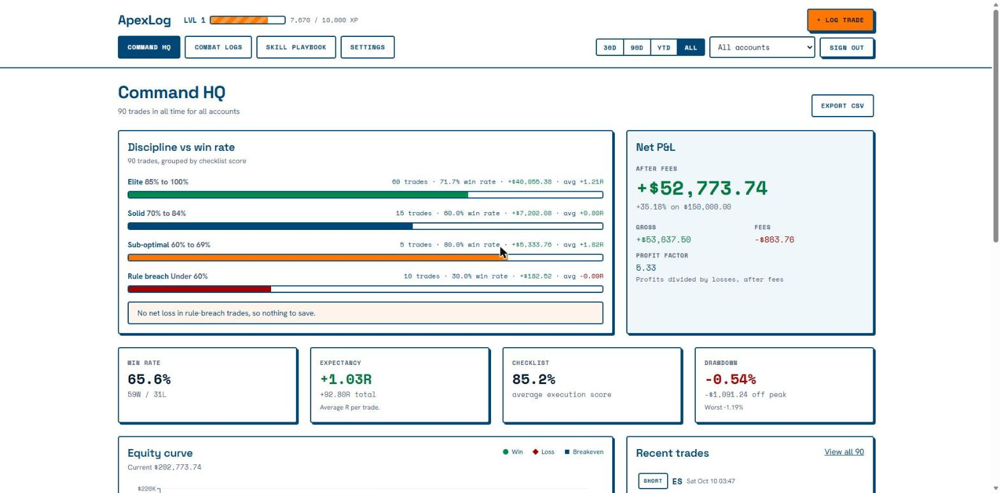
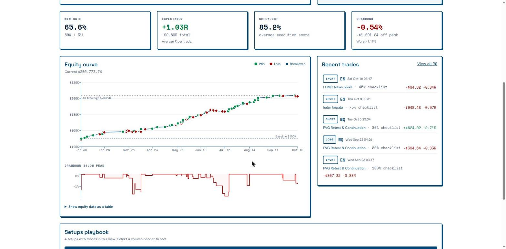
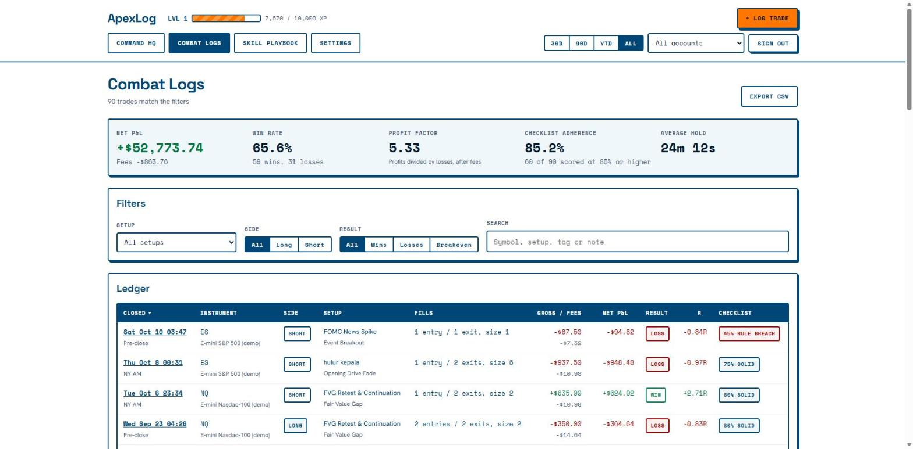
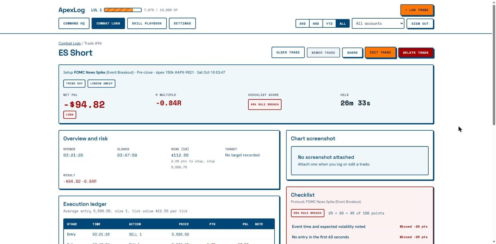

# ApexLog

**Live: https://trading-journal-eight-phi.vercel.app** (sign in with the demo account, see [docs/demo-account.md](docs/demo-account.md))





Most trading journals record what a trade made. This one records whether the trader followed their own rules, then
shows what following them is worth. Each setup carries a weighted checklist. Every trade is scored against it, and
the dashboard splits results by discipline band, so a "rule breach" trade shows how much money skipping it would
have saved.

It is a working app, built for one trader's daily use: fills with per-fill fees, planned risk and R-multiples,
multiple accounts, generic instruments (futures, forex, crypto), screenshots, CSV export and a small XP and streak
system.

## Stack

| Layer | Choice |
|---|---|
| Frontend | React 19, Vite, React Router, TanStack Query, Recharts. Plain JavaScript |
| Backend | FastAPI, SQLAlchemy, Alembic |
| Database and files | PostgreSQL and Storage on Supabase |
| Hosting | Vercel (frontend), Render (API), Supabase, all on free tiers |
| Tests | pytest against a real Postgres, Vitest and Testing Library |
| CI | GitHub Actions on every push, plus a weekly encrypted `pg_dump` |

Design: screens were mocked up in Stitch and implemented as CSS tokens in `frontend/src/tokens.css`.

## What it looks like

| Trade log | Trade detail |
|---|---|
|  |  |

## Documentation

- [Architecture and data model](docs/architecture.md): system diagram and ERD
- [Case study](docs/case-study.md): decisions, trade-offs and the problems hit along the way
- [Deploy runbook](docs/DEPLOY.md): the free-tier setup, step by step
- [Demo account](docs/demo-account.md): how the sample journal is seeded

## Run it locally

### Database

Either `docker compose up -d db` from the repo root, or use a local PostgreSQL and create the role and databases
once (as a superuser):

```
CREATE ROLE journal LOGIN PASSWORD 'journal';
CREATE DATABASE journal OWNER journal;
CREATE DATABASE journal_test OWNER journal;
```

### Backend

```
cd backend
python -m venv .venv
.venv\Scripts\pip install -r requirements.txt      # Windows
cp ../.env.example .env                             # adjust DATABASE_URL if needed
.venv\Scripts\alembic upgrade head
.venv\Scripts\python -m pytest
.venv\Scripts\python -m uvicorn app.main:app --reload --port 8000
```

DB tests skip when Postgres is unreachable. Create the login once, with `SEED_EMAIL` and `SEED_PASSWORD` set in the
environment (add `--reset` to replace an existing password), then load the sample journal:

```
.venv\Scripts\python -m scripts.seed_user
.venv\Scripts\python -m scripts.seed_demo
```

### Frontend

```
cd frontend
npm install
npm run dev        # http://localhost:5173 ; components at /kitchen-sink
npm test
npm run build
```

In dev, Vite proxies `/api` to the backend on port 8000, so the login cookie stays same-site. Deployed,
`frontend/vercel.json` forwards `/api` to the backend the same way.
