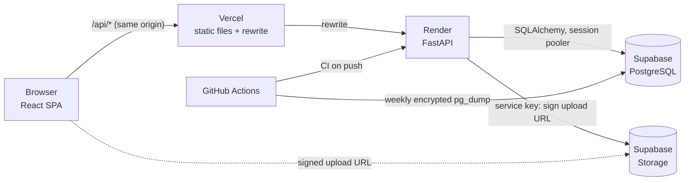
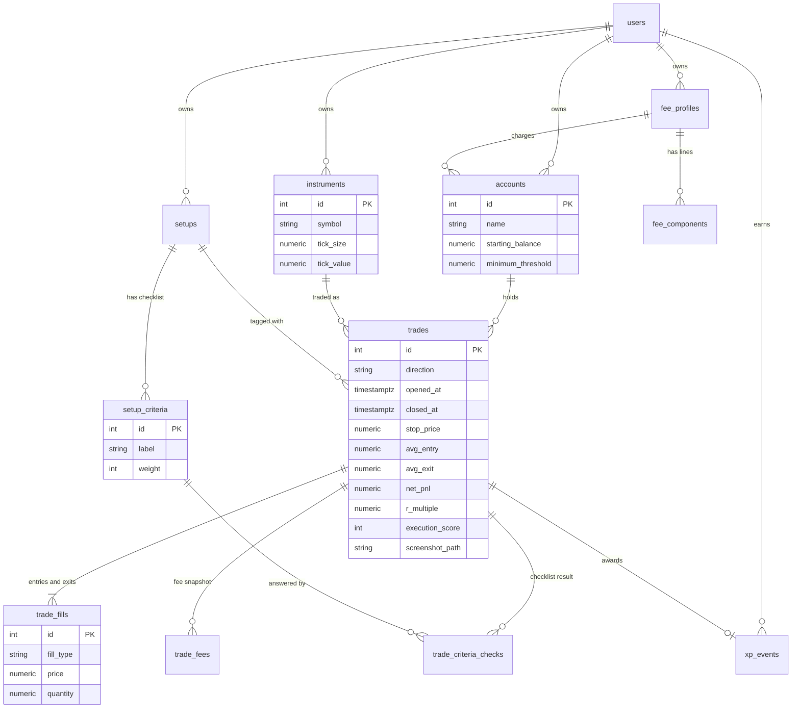

# Architecture

## System

- The browser only talks to the Vercel site. `frontend/vercel.json` rewrites `/api/*` to Render, so the login
  cookie is first-party (`SameSite=Lax`, `Secure`, no `Domain`) and no custom domain is needed.
- Only FastAPI holds Supabase credentials. The browser never calls Supabase's own data API. Row-level security is
  switched on with no public policies as a second lock.
- Screenshots go browser to Supabase Storage on a short-lived signed URL the API issues. The database stores the
  object path only.
- Auth is the app's own: a seeded user, a JWT in an httpOnly cookie, failed logins limited to 5 per 15 minutes per
  IP and per email.
- Money and price columns are `NUMERIC`, and the server computes every derived figure (P&L, R, score) on write.
  The client never supplies them.

## Data model

Column lists are abridged; the full schema is in `backend/app/models/` and the Alembic migrations.

Design decisions worth knowing:

- **Fills are the source of truth.** Quantity, average entry and exit on `trades` are derived from `trade_fills`,
  so scale-ins and partial exits work without a special case.
- **Fees are snapshotted per trade** (`trade_fees`), copied from the account's fee profile at save time. Editing a
  tariff later never rewrites history.
- **Setups are archived, never deleted**, once a trade references them (`ON DELETE RESTRICT`).
- **Execution score** is `100 * checked weight / total weight` for the trade's setup. A trade with no setup, or a
  setup with no criteria, scores `null` and is left out of averages rather than counted as 0.
- Every table is rooted to `user_id`, directly or through its parent, so opening the app to more users later does
  not need a schema rework.
